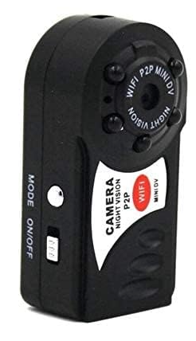

# q7-cam-mod



**Open firmware for the "Q7" mini Wi-Fi P2P camera.** The stock firmware is a closed,
proprietary app: it talks only to the vendor's own phone and desktop apps (on the local
network or through its P2P service) and calls home to servers in China. q7-cam-mod
replaces it with **camd**, a small open daemon of our own that gives you a standard MJPEG
stream, a web UI, motion and sound detection, IR night vision, SD-card recording, a file
manager, a plain HTTP API and a Home Assistant webhook. Nothing phones home; no vendor app
or account needed.

The kernel change is a single line, and everything else lives on the SD card, so it's easy
to update and easy to undo. Take the card out and the camera boots exactly like stock.

<br clear="right">

---

## Contents

- [Features](#features)
- [Is this my camera?](#is-this-my-camera)
- [How it works](#how-it-works)
- [What you need](#what-you-need)
- [Installation](#installation)
- [Using the camera](#using-the-camera)
- [Home Assistant](#home-assistant)
- [Settings reference](#settings-reference)
- [HTTP API](#http-api)
- [Maintenance](#maintenance)
- [Going back to stock / recovery](#going-back-to-stock--recovery)
- [Building from source](#building-from-source)
- [Repository layout](#repository-layout)
- [Troubleshooting](#troubleshooting)
- [Known limitations](#known-limitations)
- [Third-party components](#third-party-components)
- [License](#license)

---

## Features

- **Live video**: MJPEG at 320x240, up to 15 fps, hardware JPEG encoder, any number of
  viewers (browser, Home Assistant, VLC...). Single JPEG snapshots too.
- **Web UI** at `http://<camera>:8080/ui`: live view, listen to the microphone, all
  settings, recordings, a file manager, reboot.
- **Night vision**: IR-cut filter + IR LEDs, **Auto** (with hysteresis so it doesn't flap),
  **On** or **Off**; black-and-white picture while IR is on.
- **Motion detection** built for the camera's noisy little sensor: counts changed blocks of
  a 40x30 grid, learns each block's own flicker, ignores isolated speckle and whole-picture
  light changes (lights switching, IR toggling).
- **Sound detection** with an adjustable dBFS trigger, plus a live audio stream.
- **SD-card recording** (MJPEG `.avi`): motion clips with pre-/post-roll, or continuous;
  oldest clips deleted automatically when space runs low. Works without Wi-Fi.
- **MODE button**: short tap = record continuously, hold ~3 s = record motion clips, press
  again = stop.
- **Play recordings in the browser** (no download needed), download or delete them.
- **File manager** in the web UI: browse, edit (scripts, config), upload, download and
  delete files on the SD card; system files are marked and protected by a stricter prompt.
- **Home Assistant**: pushes motion, sound, IR, recording, brightness, motion/sound levels,
  Wi-Fi signal and supply voltage to a webhook on every change plus a heartbeat; accepts
  settings and recording commands over HTTP. Example package in [`homeassistant/`](homeassistant).
- **Telnet root shell** on port 23 (LAN only, no password).
- **NTP time sync** (configurable servers) that also sets the hardware clock.
- **Self-healing**: reboots itself if the picture ever freezes (a rare sensor/driver
  stall) or the sensor comes up stuck white after a reset. Can be switched off.
- **Gentle on the SD card**: logs live in RAM, settings are written only when you change
  them in the web UI, the card is mounted `noatime`.

## Is this my camera?

Sold under many names: "Q7 mini camera", "Mini DV WiFi P2P camera", "Night vision mini
spy camera"... It's the little black block with 4 IR LEDs around the lens, a **MODE**
button and an **ON/OFF** switch on the side, a microSD slot and a micro-USB port. Stock
firmware signs:

- the phone app is **"9527"** or **"Plug&Play"**;
- it opens a Wi-Fi hotspot called **`Q7`** (password **`12345678`**);
- a label on the back has the camera's P2P **ID** (like `MD123456`) and **password**;
- red LED on and blue flashing while it works.

Inside there's an Anyka AK37-series SoC (AK3751B), 32 MB RAM, 8 MB SPI flash, a GC0308
sensor and an RTL8188EU Wi-Fi chip, running Linux 2.6.32 (`2.6.32.9-ak37`).

> **Different hardware revisions exist.** The kernel in this repo was built from the stock
> firmware of our unit. `firmware/build_zimage.py` refuses to patch a kernel it doesn't
> recognise, so if you can dump your own flash, building from your own kernel is the
> safest route. If you flash ours without checking, make sure you can recover (see
> [recovery](#going-back-to-stock--recovery)).

## How it works

```
power on
 └─ bootloader -> kernel (with the q7-cam-mod rcS line) -> /etc/init.d/rcS
     └─ mount the SD card at /mnt/mmc (3 tries)
         ├─ /mnt/mmc/boot.sh exists?  no  -> /test/update.exe   (exactly like stock)
         └─ yes -> sh /mnt/mmc/boot.sh
              ├─ restore wifi.txt from q7mod/wifi.txt.keep if it went missing
              ├─ install q7mod/camd.new if you uploaded one
              ├─ telnetd on port 23
              ├─ q7mod/use_camd present -> replace the vendor app with a do-nothing stub
              ├─ /test/update.exe   vendor helper: SD-card firmware updater + Wi-Fi from wifi.txt
              └─ 15 s later: q7mod/pg.sh -> camd (video, everything else, :8080)
                                         -> audiod (microphone, :8081)
```

The camera's whole root filesystem is built into the kernel image and unpacked to RAM at
every boot, so the only persistent change the mod needs is the one rcS line inside the
kernel. It's patched in place at exactly the same size as the original (the image has a
trailer table with hard-coded offsets: a size change bricks the boot). The full story,
including every address we found, is in
[docs/REVERSE-ENGINEERING.md](docs/REVERSE-ENGINEERING.md); hardware notes are in
[docs/INTERNALS.md](docs/INTERNALS.md).

## What you need

- the camera;
- a **microSD card**, FAT32. A decent 8-32 GB card is best: a very slow card can take too
  long to appear at boot (the camera then just boots stock);
- a computer with an SD card reader;
- a 2.4 GHz Wi-Fi network (the camera doesn't do 5 GHz).

Optional: a **SPI flash programmer** (CH341A or similar with a SOIC-8 clip) for full backups
and last-resort recovery, and Python 3 for the helper tools.

## Installation

### 1. Flash the kernel with the camera's own SD-card updater

The stock firmware flashes any kernel it finds at `update/zImage` on the SD card at boot,
**then deletes the `update` folder** so it doesn't flash it again.

1. Format the card as **FAT32**.
2. Create a folder `update` at the top of the card and copy
   `firmware/zImage-q7mod` into it, renamed to **`zImage`**:

   ```
   SD card
   └── update
       └── zImage        (= firmware/zImage-q7mod)
   ```

3. Camera off, insert the card, switch it on. Leave it alone for **at least 2 minutes**:
   don't switch it off while it's writing the flash.
4. Switch it off and put the card back in your computer. **The `update` folder should be
   gone**: that's the sign it was flashed. (Still there? It didn't flash: check the card
   is FAT32 and the file is named exactly `update/zImage`, and try again.)

Nothing visible changes yet: without our files on the card the modded kernel boots just
like stock.

### 2. Put the mod on the SD card

Copy the **contents** of this repo's [`sdcard/`](sdcard) folder to the top of the card,
then create **`wifi.txt`** at the top of the card (see `sdcard/wifi.txt.example`): your
Wi-Fi name on the first line, its password on the second.

```
SD card
├── boot.sh          started by the modded kernel
├── wifi.txt         line 1: Wi-Fi name, line 2: password
└── q7mod/           everything else
    ├── camd         the camera daemon
    ├── audiod       microphone streaming
    ├── pg.sh        starts camd + audiod
    ├── q7ui.html    the web UI
    ├── use_camd     marker: run camd instead of the vendor app
    ├── busybox      shell tools (telnetd, ntpd, ...)
    ├── gpiodump     GPIO tool (debugging / manual reboot)
    └── fsck.fat     SD-card repair tool
```

Notes:

- `wifi.txt` must use your real network name and password, **2.4 GHz**. Plain text, no
  quotes. On first boot boot.sh keeps a spare copy in `q7mod/wifi.txt.keep` (the vendor's
  updater can delete `wifi.txt` in some situations; boot.sh puts it back).
- Leave out `use_camd` and the camera runs the vendor app (phone/desktop apps, P2P) as before,
  but with telnet and the updater still available - handy for comparisons.
- A `RECORD/` folder is created for recordings.

### 3. Boot

Insert the card and switch on. After about a minute the camera is on your network. Find
its IP address in your router's DHCP list (it shows up as the Realtek/Wi-Fi device that
appeared; giving it a fixed lease is a good idea), then open:

```
http://<camera-ip>:8080/ui
```

If it doesn't join your network, it falls back to the stock hotspot `Q7`
(password `12345678`); connect to it and the camera is at `192.168.1.1`.

### 4. First things to set (web UI -> Settings)

- **tz**: your time zone in POSIX form, e.g. `UTC0`, `CET-1CEST,M3.5.0,M10.5.0/3`,
  `EST5EDT,M3.2.0,M11.1.0`, `SAST-2`.
- **webhook**: your Home Assistant webhook URL, if you use Home Assistant.
- Motion and sound thresholds: watch the live readings while you move/talk and set the
  thresholds just above what an empty, quiet room shows.

## Using the camera

| | |
|---|---|
| Web UI | `http://<camera>:8080/ui` |
| Video stream (MJPEG) | `http://<camera>:8080/stream` |
| Snapshot (JPEG) | `http://<camera>:8080/snapshot` |
| Audio (raw S16LE 8 kHz mono) | `http://<camera>:8081/raw` |
| Audio (WAV stream) | `http://<camera>:8081/` |
| Shell | `telnet <camera> 23` (root, no password) |

**MODE button**

| Action | Result |
|---|---|
| short tap | start **continuous** recording |
| hold ~3 s | start **motion** recording (clips while there's motion) |
| press while recording mode is on | stop |

The web UI has the same two record buttons. (Separately, the `record_enabled` setting turns
on motion recording permanently.) Recording state shows in the UI and in Home Assistant;
the camera's LEDs aren't usable as indicators (see the notes).

**Recordings** are MJPEG `.avi` files in `RECORD/`, named by date/time. Play them in the
web UI (Recordings or Files -> ▶ Play), download them, or play the files in VLC.

**File manager** (web UI -> Files): browse the card, ✎ edit text files (boot.sh, pg.sh,
q7cam.ini...), ＋ create files, ⇪ upload (e.g. a new `camd.new`), ⇩ download, delete.
System files (`boot.sh`, `wifi.txt`, everything in `q7mod/`) are shown in orange and you
have to type the file name to delete one.

## Home Assistant

See [`homeassistant/`](homeassistant): a basic package with every sensor, a night-vision
selector, a recording selector, a reboot button, and an example dashboard card. No
automations: build your own on top of the entities.

1. Copy `homeassistant/q7_camera.yaml` to `/config/packages/`, replace `192.168.1.100`
   with your camera's IP and the webhook id with a random string of your own.
2. In the camera's web UI set **webhook** to
   `http://<home-assistant>:8123/api/webhook/<your id>` and save.
3. Restart Home Assistant.
4. Add the **MJPEG IP Camera** integration: MJPEG URL `http://<camera>:8080/stream`,
   still image URL `http://<camera>:8080/snapshot`.
5. Paste `homeassistant/dashboard-card.yaml` into a dashboard card.

You get: motion, sound, night vision and recording binary sensors; brightness, motion
level, sound level, last clip, recording mode, Wi-Fi signal, voltage, battery and
last-seen sensors; `select.q7_camera_night_vision_mode` (auto/on/off);
`select.q7_camera_recording` (off/continuous/motion); `button.q7_camera_reboot`.

camd pushes its full status JSON (see `/status.json` below) to the webhook on every change
of motion, sound, IR, recording or brightness, and every `heartbeat_s` seconds.

## Settings reference

All settings are in `q7mod/q7cam.ini` on the card (`key=value`, comments start with `#`),
editable in the web UI (saved to the card) or over HTTP (`/settings?key=value`; add
`&save=0` to apply without writing the card). [restart] = needs a reboot to take effect.

| Setting | Default | Range | Meaning |
|---|---|---|---|
| `width` / `height` | 320 / 240 | max 320x240 | capture size [restart] (640x480 freezes the camera driver) |
| `quality` | 70 | 20-95 | JPEG quality |
| `stream_fps` | 15 | 1-25 | max stream frame rate while someone watches |
| `idle_fps` | 1 | 1-5 | snapshot refresh rate when nobody watches |
| `capture_fps` | 10 | 2-25 | frames analysed per second (motion, brightness) |
| `sensor_brightness` / `sensor_contrast` | 3 / 3 | 0-6 | sensor settings |
| `ir_mode` | auto | auto/on/off | night vision |
| `ir_on_below` | 25 | 0-255 | auto: IR on when brightness stays below this |
| `ir_off_above` | 80 | 0-255 | auto: IR off when brightness stays above this |
| `ir_off_margin` | 40 | 0-255 | auto: IR off only when this much brighter than the IR-lit picture |
| `ir_hold_s` | 15 | 1-600 | auto: seconds the condition must hold |
| `ir_min_dwell_s` | 60 | 0-3600 | auto: minimum seconds between switches |
| `night_mono` | 1 | 0/1 | black-and-white picture while IR is on |
| `motion_enabled` | 1 | 0/1 | motion detection |
| `motion_blocks` | 6 | 1-600 | changed blocks (of 40x30) needed for motion; higher = less sensitive |
| `motion_block_level` | 8 | 2-80 | brightness change that counts a block as changed; higher = less sensitive |
| `motion_frames` | 3 | 1-30 | consecutive frames needed |
| `motion_hold_s` | 3 | 0-60 | motion stays on this long after the last trigger |
| `motion_ignore_light` | 1 | 0/1 | ignore sudden whole-picture brightness changes |
| `record_enabled` | 0 | 0/1 | record motion clips (always on) |
| `record_fps` | 5 | 1-15 | recording frame rate |
| `record_pre_s` / `record_post_s` | 2 / 5 | | seconds kept before / after motion |
| `record_max_s` | 120 | 10-1800 | max clip length (continuous recording is split into clips this long) |
| `record_keep_free_mb` | 10 | 1-4096 | delete oldest clips to keep this much free |
| `sound_enabled` | 1 | 0/1 | sound detection |
| `sound_db` | -20 | -90-0 | sound trigger level, dBFS (higher = louder needed) |
| `sound_hold_s` | 5 | 1-60 | sound stays on this long after the last loud peak |
| `webhook` | (empty) | | Home Assistant webhook URL (empty = no pushes) |
| `heartbeat_s` | 30 | 5-3600 | heartbeat push interval |
| `tz` | UTC0 | | time zone (POSIX TZ string) |
| `ntp_servers` | pool.ntp.org,time.google.com | | comma-separated; empty = no time sync |
| `port` | 8080 | | HTTP port [restart] |
| `auto_reboot` | 1 | 0/1 | reboot when the picture freezes or the sensor comes up stuck white (set 0 while working on the board without the sensor) |

## HTTP API

Port 8080 (camd). All `GET` unless noted. CORS is open (`Access-Control-Allow-Origin: *`).

| Endpoint | |
|---|---|
| `/stream` (also `/`, `/video`, `/mjpeg`) | MJPEG stream (`multipart/x-mixed-replace`) |
| `/snapshot` (also `/shot.jpg`, `/photo.jpg`) | latest frame as JPEG |
| `/status.json` | state and readings (below) |
| `/settings` | all settings with type, range and help, as JSON |
| `/settings?k=v&k2=v2[&save=0]` | change settings; `save=0` = RAM only |
| `/record?mode=continuous\|motion\|off` | recording mode, like the MODE button |
| `/recordings` | list of clips |
| `/rec/<name>[?delete=1]` | download / delete a clip |
| `/play?path=/mnt/mmc/RECORD/<name>` | play a clip as an MJPEG stream (use in an ``) |
| `/fs?path=<dir>` | list a folder on the card (JSON) |
| `/fs?path=<file>[&dl=1]` | get a file (`dl=1` = as download) |
| `POST /fs?path=<file>` | write a file (request body = content; written safely via a temp file) |
| `/fs?path=<path>&delete=1` | delete a file or empty folder |
| `/night`, `/day` | IR on / off (sets `ir_mode`) |
| `/irstate` | `1` / `0` |
| `/reboot?confirm=1` | reboot (back in about a minute) |
| `/ui` | the web UI |

All file paths must be under `/mnt/mmc`.

`/status.json` example:

```json
{"type":"status","motion":false,"motion_score":0,"motion_peak":2,"sound":false,
 "sound_peak":-38,"sound_listening":true,"brightness":118,"ir_baseline":-1,"night":false,
 "ir_mode":"auto","recording":false,"rec_mode":"off","last_clip":"20261023-220342.avi",
 "viewers":1,"fps":9.1,"width":320,"height":240,"uptime":5321,"sd_free_mb":7120,
 "sd_total_mb":7580,"wifi_dbm":-45,"battery_mv":4272,"battery_pct":100,
 "battery_status":"Discharging","charger":false,"version":"camd 1.0"}
```

`battery_mv` is the voltage on the battery terminals (if you power the camera there from a
supply instead of a battery, it's the supply voltage and `battery_pct` is meaningless);
`charger` is whether USB power is connected to the charging input.

Audio, port 8081 (audiod): `/raw` raw S16LE mono ~8 kHz, `/` the same as a streaming WAV.

## Maintenance

**Update camd or the web UI**: upload the new file through the web UI's file manager
(`q7mod/camd.new` for camd - it's installed on the next boot - or `q7mod/q7ui.html`),
or copy it onto the card in a computer, then reboot. From a shell:
`python tools/camput.py src/out/camd /mnt/mmc/q7mod/camd.new` (set `Q7_HOST` first).

**Logs** (in RAM): `/tmp/camd.log`, `/tmp/audiod.log`. `telnet <camera>` then
`tail /tmp/camd.log`.

**Back up your own flash** (do this once - it includes your unit's ID and settings):

```sh
telnet <camera>
cat /dev/mtd0 > /mnt/mmc/my-flash-backup.bin && sync
```

then copy `my-flash-backup.bin` off the card and keep it somewhere safe.

**Repair the card** after an unclean power-off: `/tmp/busybox umount /mnt/mmc` won't work
while camd runs, so run `/mnt/mmc/q7mod/fsck.fat -n /dev/mmcblk0p1` to check, or repair it
in a computer.

**Reboot without the web UI**: `telnet` in and run
`/mnt/mmc/q7mod/gpiodump set 4 1` (the board resets within about 40 s).

## Going back to stock / recovery

**Run the vendor app again (no flashing):** delete `q7mod/use_camd` from the card and
reboot. Or take the card out entirely: the modded kernel without `boot.sh` boots exactly
like stock.

**Restore the stock kernel (SD card, no tools):** same as installing, but with
`firmware/zImage-stock` copied to `update/zImage` on the card. The SD-card updater works
in both the stock and the modded firmware, and deletes the folder when done.

**Full recovery with a SPI programmer** (if the camera doesn't boot at all): write
`firmware/stock-flash-8MB-noconfig.bin` (or, better, your own backup) to the 8 MB SPI
flash chip with a CH341A or similar. This image is a complete stock flash (bootloader +
stock kernel) with the two per-unit config blocks **erased**:

- `0x7FE000` - the factory identity (the P2P ID and password from the camera's label),
- `0x7FF000` - the user config (it held our Wi-Fi name and password).

So after flashing it the camera has no P2P identity and no stored Wi-Fi: it works with
this mod, but the vendor's apps and P2P service won't recognise it. If you
have your own backup, restore that instead, or copy your own last 8 KB (`0x7FE000-0x7FFFFF`)
over the image before writing it.

**Kernel images**

| File | |
|---|---|
| `firmware/zImage-q7mod` | stock kernel + the q7-cam-mod rcS line (md5 `ab3ada6c5954de415334b8f320eb8e83`) |
| `firmware/zImage-stock` | the untouched stock kernel (md5 `1145e4020ae0740935d51d4c177fac8e`) |
| `firmware/stock-flash-8MB-noconfig.bin` | full 8 MB stock flash, per-unit config erased |
| `firmware/build_zimage.py` | builds `zImage-q7mod` from a stock zImage or a full flash dump |

Build your own: `python firmware/build_zimage.py firmware/zImage-stock` reproduces
`zImage-q7mod` byte for byte; `python firmware/build_zimage.py my-flash-backup.bin` builds
one from your own camera's kernel.

## Building from source

The prebuilt binaries in `sdcard/q7mod/` are ready to use. To build them yourself (Linux
or WSL):

- **camd** links the vendor's hardware JPEG and memory libraries (`src/libs`, copied from
  the camera) and needs a **glibc** cross-compiler whose output runs on the camera's
  glibc 2.10: Bootlin's `armv5-eabi--glibc--stable-2018.11-1`
  ([toolchains.bootlin.com](https://toolchains.bootlin.com/)). Newer toolchains produce
  binaries that need GLIBC_2.34 and won't run.
- **audiod**, **gpiodump**: static, with any `arm-linux-musleabi` cross-compiler
  (e.g. from [musl.cc](https://musl.cc/)).

```sh
BTL=/path/to/armv5-eabi--glibc--stable-2018.11-1/bin \
MUSL=/path/to/arm-linux-musleabi-cross/bin \
bash src/build.sh            # camd audiod gpiodump -> src/out/
bash src/build.sh ioshim     # optional: the LD_PRELOAD tracer used for reverse engineering
```

`busybox` (1.35.0, static ARMv5) and `fsck.fat` (dosfstools 4.2, static) are standard
builds of those projects.

**tools/** (Python 3, talk to the telnet shell; set `Q7_HOST=<camera-ip>`):

- `camsh.py "command"` - run shell commands and print the output;
- `camput.py <local file> <remote path>` - copy a file to the camera (base64 over telnet,
  md5-checked).

## Repository layout

```
README.md                 this file
LICENSE                   MIT
docs/
  INTERNALS.md            hardware, flash layout, GPIOs, capture/JPEG/audio notes
  REVERSE-ENGINEERING.md  how it was done: addresses, patches, traces, dead ends
  q7-camera.png
firmware/
  zImage-q7mod            modded kernel (flash via SD: update/zImage)
  zImage-stock            stock kernel (same way, to undo)
  stock-flash-8MB-noconfig.bin   full stock flash for SPI recovery
  build_zimage.py         builds the modded kernel
sdcard/                   copy the contents to the SD card (+ your wifi.txt)
  boot.sh
  wifi.txt.example
  q7mod/                  camd, audiod, pg.sh, q7ui.html, use_camd, busybox, gpiodump, fsck.fat
src/
  camd.c                  the camera daemon
  audiod.c                microphone streaming
  gpiodump.c              GPIO read/set tool
  ioshim.c                LD_PRELOAD tracer (reverse engineering)
  build.sh
  libs/                   vendor libakimage / libakuio, for linking camd
tools/                    camsh.py, camput.py (telnet helpers)
homeassistant/            q7_camera.yaml package + dashboard-card.yaml
```

## Troubleshooting

**The `update` folder is still on the card after step 1.** It didn't flash. Use a FAT32
card, the exact path `update/zImage`, and leave the camera on for 2 minutes.

**The camera doesn't show up on the network.** Check `wifi.txt` (2.4 GHz network, name on
line 1, password on line 2, no extra spaces). Look for the `Q7` hotspot: if it's there,
the camera couldn't join your network. Connect to `Q7` (password `12345678`) and try
`http://192.168.1.1:8080/ui` and `telnet 192.168.1.1`.

**No web UI, but the camera is on the network.** The card may not have been ready in time
(slow card) and the camera booted stock: try another card. Otherwise `telnet` in and read
`/tmp/camd.log`.

**The picture is white / washed out.** After some resets the sensor ignores its setup; camd
detects this and reboots by itself (if `auto_reboot` is on). A power-cycle fixes it too.

**The picture froze.** A rare sensor/driver stall; with `auto_reboot` on, camd reboots
within ~10 s and the camera is back in about a minute.

**The camera keeps rebooting.** Most likely the sensor isn't working (unplugged ribbon,
damaged). Set `auto_reboot=0` (web UI, or edit `q7mod/q7cam.ini` on the card) to stop the
automatic reboots while you investigate.

**Motion triggers too much / too little.** Watch "Changed blocks" in the web UI: set
`motion_blocks` a bit above what the empty room shows, and raise `motion_block_level` if
the dark IR picture's noise triggers it.

## Known limitations

- 320x240 maximum (the driver hangs at 640x480).
- MJPEG only, no RTSP/H.264 (use go2rtc if you need RTSP; it can take the MJPEG stream).
- No speaker, so no two-way audio.
- The red/blue LEDs are run by the vendor's power logic and can't be used as indicators.
- The microphone is a tiny ADC at ~8 kHz: fine for "is there noise", not for recordings
  worth listening to.
- Only one hardware revision tested.

## Third-party components

This repository's own code and documentation are MIT-licensed. It also contains, for
convenience, components that are **not** covered by that license and remain the property
of their respective authors:

- `firmware/zImage-stock`, `firmware/stock-flash-8MB-noconfig.bin` and the stock parts of
  `firmware/zImage-q7mod`: the camera vendor's firmware (Linux kernel under the GPL,
  plus the vendor's own userland), provided as a recovery aid for owners of this camera;
- `src/libs/libakimage.so.0.1.0`, `src/libs/libakuio.so.0.1.0`: Anyka libraries from the
  camera's firmware, needed to link camd;
- `sdcard/q7mod/busybox`: [BusyBox](https://busybox.net) 1.35.0, GPLv2;
- `sdcard/q7mod/fsck.fat`: [dosfstools](https://github.com/dosfstools/dosfstools) 4.2, GPLv3.

Use at your own risk: flashing firmware can brick a device, and this is an unofficial
modification not affiliated with the camera's manufacturer.

---

## License

MIT License. See [`LICENSE`](LICENSE) for details.

---

## Contributing

Pull requests, forks, issues and suggestions are all welcome.

---

## Support

If q7-cam-mod has been useful to you, consider buying me a coffee:

**PayPal:** [](https://www.paypal.com/donate/?business=2CGE77L7BZS3S&no_recurring=0)  
**BTC:** `1Q4QkBn2Rx4hxFBgHEwRJXYHJjtfusnYfy`  
**XMR:** `4AfeGxGR4JqDxwVGWPTZHtX5QnQ3dTzwzMWLBFvysa6FTpTbz8Juqs25XuysVfowQoSYGdMESqnvrEQ969nR9Q7mEgpA5Zm`
